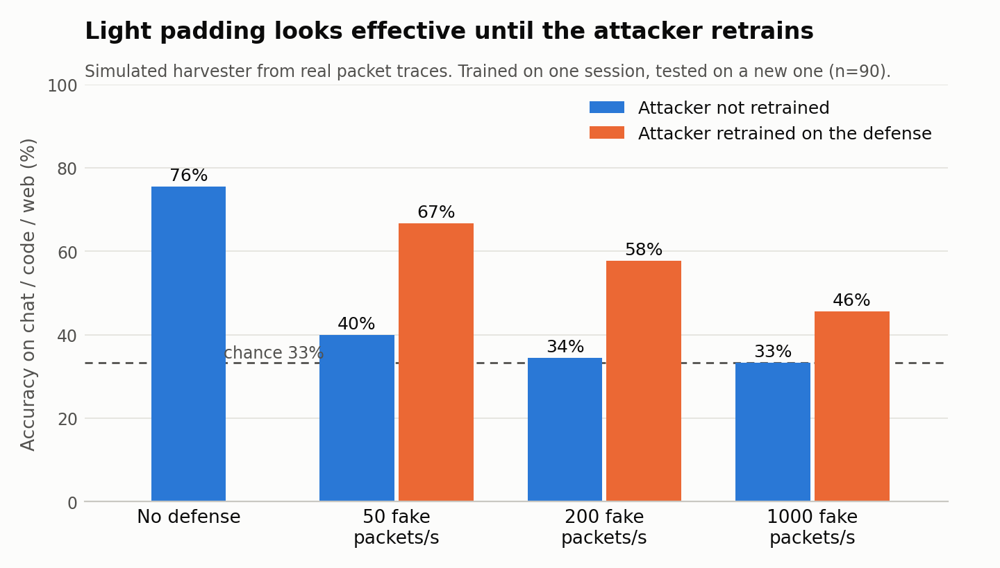

# Does a Wi-Fi power side-channel defense survive an attacker who retrains?

A small pilot. It records packet timing and size from three command-line AI-agent tasks (chat, code, web) on my own Wi-Fi, passes them through a simulated energy harvester, and tests fake-traffic defenses against an attacker who is and is not retrained.

**This is not a hardware result.** The harvester is simulated, and the fake traffic is added to recorded packets in software.

## Result

Trained on one session and tested on a new one (90 runs per session, 30 per class). Guessing gives 33%.

| Fake packets/s | Attacker not retrained | Attacker retrained |
|---|---:|---:|
| None | 76% | n/a |
| 50 | 40% | 67% |
| 200 | 34% | 58% |
| 1000 | 33% | 46% (gain not clearly above zero) |



## Limits

- One laptop, one network and one day.
- An earlier LSTM model scored near chance on the same training data (`retry/results.json`). The logistic regression and test rules were fixed before the test session (`PREREGISTRATION.md`).
- The later hide-the-end defense results are exploratory (`DEFENSE_TEST_PLAN.md`).

## Data

Each file in `data/`, `retry/data/` and `session2/data/` holds only packet time, length and direction. Packet contents and IP addresses are not stored.

## Reproduce

```
pip install numpy scipy scikit-learn matplotlib
python3 confirm.py
python3 plot.py
```

`confirm.py` prints the results above and rewrites `session2/confirm_results.json`. `session2.sha256` holds the hashes of the test plan and script from before the test session. `collect.py` shows the exact agent command and prompts, and needs its own setup to record new data.
